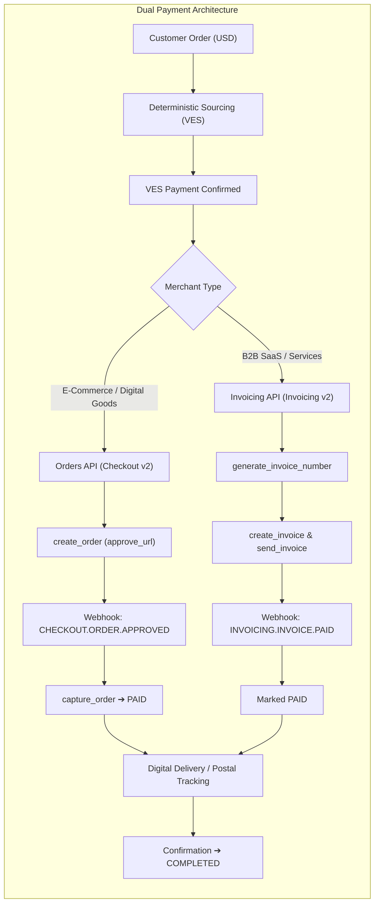

# PUENTE 🌉 — Autonomous P2P Cross-Border Purchasing on PayPal

> **PayPal AI Hackathon: Build What's Next with PayPal and AI (Devpost)**  
> *Empowering Venezuelans and unbanked Latin Americans to purchase USD goods and services with local currency (VES), orchestrated deterministically over the official PayPal Agent Toolkit.*

[](https://agent-puente.onrender.com/health)
[](https://github.com/AdrianLS4/Agent_Puente/tree/main/tests)
[](https://github.com/AdrianLS4/Agent_Puente)
[](https://opensource.org/licenses/MIT)

---

## 🌟 1. The Problem: A Real-World Financial Wall

In Venezuela and across emerging markets, millions of talented freelancers, students, and businesses face an absurd barrier:
- They earn or hold local currency (**Bolívares / VES**).
- Global merchants, SaaS providers, and educational platforms only accept **USD via PayPal or international credit cards**.
- Local banks cannot issue international credit cards due to strict exchange controls and currency sanctions.

Buying a \$29 annual software license, a cloud server, or an educational course is almost impossible for an everyday citizen without relying on shady, high-fee black-market intermediaries.

---

## 💡 2. The Solution: PUENTE (The Bridge)

**PUENTE** is an AI-assisted, peer-to-peer (P2P) cross-border purchasing protocol powered by the **PayPal Agent Toolkit**:

1. **The Customer:** Requests to purchase an item priced in USD, paying in local currency (VES).
2. **The Protocol:** Real-time FX engine queries live parallel rates; a deterministic multi-criteria algorithm ranks verified liquidity providers (scored on price, Bayes-smoothed reliability, speed, dispute rate, and KYC).
3. **The Provider (P2P):** A verified user with USD PayPal balance receives local VES and authorizes the transaction.
4. **The Merchant:** Receives official USD funds directly into their PayPal account via:
   - **Pathway A (Retail Checkout):** Direct `create_order` + `capture_order` v2 checkout.
   - **Pathway B (B2B Services):** Formal electronic `create_invoice` + `send_invoice` v2 invoicing.
5. **The Agent:** Monitors fulfillment, logs SHA-256 digital proof or postal tracking, listens to live PayPal webhooks on **Render**, handles disputes with guardrails, and automates failovers if a provider stalls.

---

## 🏗️ 3. Architecture: Why Judges & Engineers Love PUENTE

### Core Rule: *The LLM Never Touches the Money*
Most hackathon AI agents are fragile prompt wrappers that hallucinate prices and trigger unauthorized payments. **PUENTE is engineered with solid architectural foundations:**

```
                    ┌────────────────────────── DETERMINISTIC ORCHESTRATOR ──────────────────────────┐
  Customer (VES) ─▶ │ 16-State Finite State Machine · SQLite Ledger · Exponential Backoff · Idempotency │
                    └───────┬───────────────────────────────┬──────────────────────────────┬──────────┘
                            │                               │                              │
                      IntakeAgent                     SourcingAgent                  ResolutionAgent
                  (Natural Language           (Transparently explains the       (Chooses ONLY from code-
               Text ➔ PurchaseIntent)          Top-1 provider ranking)           allowed dispute actions)
                            │                               │                              ▲
                            └───────────────────────────────┴─────────────── policy.allowed_dispute_actions
                                                            │
                                         ┌──────────────────┴──────────────────┐
                                         │      PAYPAL AGENT TOOLKIT v1.11     │
                                         │  • Orders: create, get, pay/capture │
                                         │  • Invoicing: create, send, get     │
                                         │  • Disputes & Tracking API          │
                                         └─────────────────────────────────────┘
```

### Key Architectural Highlights:
- **16-State Finite State Machine ([state_machine.py](file:///c:/Users/Mistake/OneDrive/Escritorio/PROYECTOS/puente-agent/src/puente/state_machine.py)):** Every state transition is atomic and immutable. Only valid transitions can occur.
- **30-Error Automated Catalog ([ERRORS.md](file:///c:/Users/Mistake/OneDrive/Escritorio/PROYECTOS/puente-agent/docs/ERRORS.md)):** Prescriptive playbooks for HTTP 429 rate limits, network timeouts (5xx), instrument declines, and silent provider timeouts.
- **Provider Failover & Auto-Compensation:** If a provider fails to approve within 15 minutes (`E_PP_NOT_APPROVED`), the protocol automatically refunds the customer's VES, penalizes the provider's ranking score, and seamlessly re-quotes with provider #2.
- **Strict Idempotency:** Native `PayPal-Request-Id` headers and database unique constraints (`paypal_event_id UNIQUE`, `reference UNIQUE`) ensure that duplicate webhooks or network retries **never duplicate financial operations**.
- **Dispute Guardrails ([policy.py](file:///c:/Users/Mistake/OneDrive/Escritorio/PROYECTOS/puente-agent/src/puente/policy.py)):** High-value disputes (> \$50) or imminent deadlines (< 48h) automatically escalate to human review; the LLM is restricted to strictly verified delivery evidence.

---

## 🔄 4. Dual Payment Pathways

PUENTE implements two distinct payment flows on top of the PayPal Agent Toolkit:



---

## 🚀 5. Live Production Deployment on Render

PUENTE is deployed as a 24/7 cloud service on **Render** (official hackathon infrastructure partner):

- **Health Check Endpoint:** [https://agent-puente.onrender.com/health](https://agent-puente.onrender.com/health)
- **Live PayPal Webhooks Endpoint:** `https://agent-puente.onrender.com/webhooks/paypal`
- **Automated CI/CD:** Connected to GitHub via [render.yaml](file:///c:/Users/Mistake/OneDrive/Escritorio/PROYECTOS/puente-agent/render.yaml) with `autoDeploy: true`. Every push triggers automated zero-downtime builds.

---

## 🧪 6. Quickstart & Local Verification

### 1. Setup Environment
```bash
git clone https://github.com/AdrianLS4/Agent_Puente.git
cd Agent_Puente
python -m venv .venv
source .venv/bin/activate  # On Windows: .\.venv\Scripts\Activate.ps1
pip install -e ".[dev]"
```

### 2. Run the Automated Test Suite (67 Tests)
```bash
python -m pytest -q
# Output: 67 passed in 1.2s
```

### 3. Launch the 3-Column Interactive Web UI (`puente-ui`) + ReAct Concierge (`concierge.py`)
```bash
# Terminal 1: Start the FastAPI backend + Gemini ReAct Concierge
python -m uvicorn puente.server:app --port 8000

# Terminal 2: Start the 3-Column React + Vite UI (Customer · Provider · State)
cd puente-ui
npm install
npm run dev
# Open http://localhost:5173
```

### 4. Run the CLI Demos (8 Scenarios & Interactive ReAct Console)
The built-in CLI tests both offline mock scenarios and live sandbox runs:
```bash
# Interactive ReAct Agent in terminal (Gemini Function Calling + code confirmation):
python -m puente.concierge --live

# Run all 8 scenarios (happy path, invoices, retries, failovers, dispute contest/accept/human):
python -m puente.cli demo all

# Test the Invoicing B2B flow:
python -m puente.cli demo invoice

# Run live sandbox checkout against real PayPal Sandbox with live parallel FX:
python -m puente.cli demo happy --live

# Start the FastAPI Webhook Receiver locally:
python -m puente.cli serve --port 8000
```

---

## 📊 7. Test Matrix & Verification Coverage

| Feature / Scenario | Implementation File | Verified In Sandbox / Tests |
|---|---|---|
| **Deterministic Ranking** | [ranking.py](file:///c:/Users/Mistake/OneDrive/Escritorio/PROYECTOS/puente-agent/src/puente/ranking.py) | ✅ Verified (price, Bayes reliability, speed, dispute penalty) |
| **Live Parallel FX Rate** | [fx.py](file:///c:/Users/Mistake/OneDrive/Escritorio/PROYECTOS/puente-agent/src/puente/fx.py) | ✅ Verified live (real-time parallel rate via `ve.dolarapi.com`) |
| **PayPal Sandbox Orders** | [paypal_gateway.py](file:///c:/Users/Mistake/OneDrive/Escritorio/PROYECTOS/puente-agent/src/puente/paypal_gateway.py) | ✅ Verified in Sandbox (Order `6GK30735HW9171720` captured) |
| **PayPal B2B Invoices** | [paypal_gateway.py](file:///c:/Users/Mistake/OneDrive/Escritorio/PROYECTOS/puente-agent/src/puente/paypal_gateway.py) | ✅ Verified in Sandbox (Draft, Send, Paid webhook) |
| **Webhook Receiver & Idempotency** | [server.py](file:///c:/Users/Mistake/OneDrive/Escritorio/PROYECTOS/puente-agent/src/puente/server.py) | ✅ Verified live (received real webhook from PayPal `173.0.81.140`) |
| **Cloud Deployment** | [render.yaml](file:///c:/Users/Mistake/OneDrive/Escritorio/PROYECTOS/puente-agent/render.yaml) | ✅ Verified live on Render cloud (HTTP 200 OK) |
| **Failover on Inactivity** | [orchestrator.py](file:///c:/Users/Mistake/OneDrive/Escritorio/PROYECTOS/puente-agent/src/puente/orchestrator.py) | ✅ Verified (timeout refund in VES + provider penalty) |
| **Automated Dispute Resolution** | [policy.py](file:///c:/Users/Mistake/OneDrive/Escritorio/PROYECTOS/puente-agent/src/puente/policy.py) | ✅ Verified (contest with proof, accept on small amounts, human triage) |

---

## 👥 Authors & Acknowledgments

- **Lead Developer:** Adrian Sandoval ([@AdrianLS4](https://github.com/AdrianLS4))
- Built for the **PayPal AI Hackathon: Build What's Next with PayPal and AI** on [Devpost](https://devpost.com).
- Powered by the **PayPal Agent Toolkit** (`paypal-agent-toolkit`), **FastAPI**, and deployed on **Render**.
