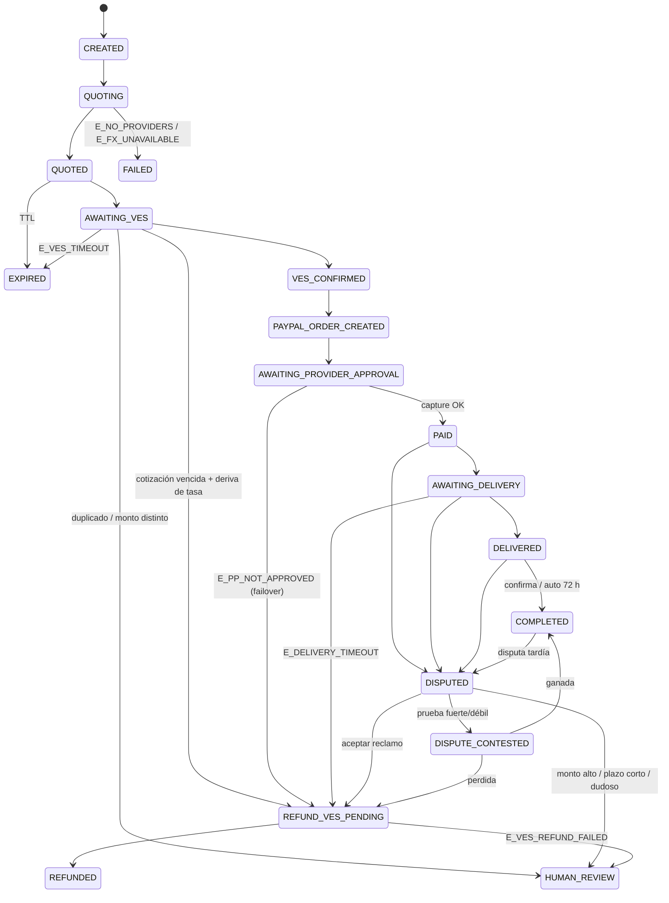

# PUENTE — Flujo del agente, algoritmo y cuentas sandbox

## 1. Roles y cuentas sandbox

| Rol | Quién es en producción | Qué usas en el hackathon |
|---|---|---|
| **Cliente** | Venezolano que quiere pagar algo en USD y no tiene saldo PayPal | Fila en `customers`. Paga en Bs. → **simulado** (sin Pago Móvil real) |
| **Proveedor** | Persona/negocio verificado con saldo USD en PayPal que cobra en Bs. | **Cuenta sandbox PERSONAL** (A). Aprueba la orden en PayPal. Crea una 2ª personal (B) para el demo de failover |
| **Comercio** | Tienda/servicio real que cobra en USD | **Cuenta sandbox BUSINESS** (la de la app REST). El toolkit crea las órdenes con sus credenciales |
| **Agente PUENTE** | Orquestador + agentes LLM | Este repo |

Pasos (developer.paypal.com): *Apps & Credentials → Sandbox → Create App* (la app queda ligada a una cuenta Business sandbox) → *Testing Tools → Sandbox Accounts* para crear 1–2 cuentas Personal con saldo ficticio. Copia `Client ID` y `Secret` al `.env`.

> ⚠ Por verificar el día 1: cómo abrir una disputa de prueba en sandbox (lo esperable es hacerlo desde la cuenta Personal en el Resolution Center sandbox y copiar el `dispute_id`), y que los endpoints REST de reembolso/tracking/disputas respondan en tu sandbox.

## 2. Diseño: quién decide qué

```
                    ┌────────────────────────── ORQUESTADOR (código determinista) ─────────────────────────┐
 cliente (ES) ───▶  │ máquina de estados · BD · reintentos · compensación · timeouts · catálogo de errores   │
                    └───────┬───────────────────────┬───────────────────────────┬───────────────────────────┘
                            │                       │                           │
                     IntakeAgent             SourcingAgent               ResolutionAgent
                  (texto → PurchaseIntent)  (explica el ranking)   (elige entre acciones PERMITIDAS)
                                                                         ▲ policy.allowed_dispute_actions
                            PayPal Agent Toolkit: create_order / get_order_details / capture_order (+ invoices)
                            REST propio: reembolso · tracking · disputas   (el toolkit 1.1.0 no los trae)
```

Regla: **el LLM nunca mueve dinero ni cambia estados**. Elige o explica dentro de límites que el código impone. Si el LLM falla o propone algo prohibido → reglas de respaldo o cola humana.

## 3. Máquina de estados



Timeouts (los revisa `check_timeouts()`, pensado para correr cada minuto): cotización 15 min (10 + 5 de gracia) · pago Bs. 30 min · aprobación PayPal 15 min · entrega 24 h · auto-completar 72 h.

## 4. Algoritmo por etapa

### 4.1 Intake
```
texto del cliente ──IntakeAgent──▶ PurchaseIntent{item, monto?, banco?}      (campos faltantes = null, no se inventan)
create_request(cliente, item, banco, idempotency_key)
    si la key ya existe                      → devolver la solicitud existente   [E_IDEMPOTENT_REPLAY]
    si monto > MAX_AMOUNT_USD                → rechazar sin cotizar              [E_AMOUNT_LIMIT]
```

### 4.2 Búsqueda y ranking de proveedores (determinista, `ranking.py`)
```
ref_rate = tasa de referencia USD/VES
    fuente falla → último valor guardado si tiene < 15 min; si no → ABORT        [E_FX_UNAVAILABLE]

FILTROS DUROS (cada descarte guarda su motivo):
    inactivo · PayPal no verificado · KYC < mínimo · capacidad USD < monto ·
    banco del cliente no soportado · (≥10 órdenes y tasa de disputas > 10 %)
    si no queda ninguno                                                          [E_NO_PROVIDERS]

PRECIO por proveedor:
    tasa_p     = ref_rate × (1 + margen_p/100)
    total_VES  = (monto_USD + fee_USD_p) × tasa_p

SCORE 0–100 = 100 × Σ peso × componente(0..1)
    precio       40 %   1 − (total/mejor_total − 1)/10 %      (10 % más caro que el mejor → 0)
    confiabil.   25 %   (completadas + 4.5) / (completadas + disputadas + falladas + 5)   (suavizado Beta)
    velocidad    15 %   1 − minutos_promedio/60
    disputas     10 %   1 − (disputadas + 0.5)/(total + 5) / 10 %
    KYC           5 %   nivel/3
    capacidad     5 %   min(capacidad/(3 × monto), 1)

orden: score desc → confiabilidad desc → total_VES asc  → top-3 con `score_breakdown` guardado
SourcingAgent explica el #1 usando solo esos números (no altera el orden)
```

### 4.3 Pago en bolívares (simulado)
```
select_quote(rank)   → si la cotización venció (TTL + gracia)           → EXPIRED       [E_QUOTE_EXPIRED]
                     → crea ves_payment 'pending'  → AWAITING_VES
confirm_ves(ref, monto_ves):
    referencia ya usada                                → HUMAN_REVIEW                [E_VES_DUPLICATE_REF]
    |monto − total| > 0.5 %                            → HUMAN_REVIEW                [E_VES_AMOUNT_MISMATCH]
    cotización vencida y deriva de tasa > 1 %          → devolver Bs.                [E_QUOTE_EXPIRED]
    si todo OK                                         → VES_CONFIRMED
(si pasan 30 min sin pago → EXPIRED, sin mover dinero)                               [E_VES_TIMEOUT]
```

### 4.4 Orden de PayPal
```
create_paypal_order:
    ya existe una orden CREATED/APPROVED para la solicitud → devolverla (no duplicar)
    toolkit.create_order(USD, ítem) con política del catálogo:
        429 → reintentar 2,4,8,16 s · 5xx/timeout → 3 reintentos · 401 → 1 reintento
        agotados → HUMAN_REVIEW
    guarda paypal_orders, RESERVA capacidad del proveedor → AWAITING_PROVIDER_APPROVAL
    el proveedor abre approve_url y aprueba (cuenta sandbox personal)

capture (idempotente; se puede llamar por polling o webhook):
    get_order_details:
        COMPLETED                → ya capturada, continuar        [E_PP_ALREADY_CAPTURED]
        CREATED/sin aprobar      → esperar
        APPROVED                 → capture_order
    INSTRUMENT_DECLINED          → esperar (el proveedor elige otra fuente de fondos)
    captura PENDING              → NO entregar; esperar            [E_PP_CAPTURE_PENDING]
    DENIED/DECLINED              → como no aprobado (failover)
    monto capturado ≠ esperado   → HUMAN_REVIEW                    [E_PP_AMOUNT_MISMATCH]
    OK → PAID → crea `deliveries` con deadline 24 h → AWAITING_DELIVERY
```

### 4.5 Seguimiento de pago y entrega
```
record_delivery:
    físico: add_tracking(capture_id, tracking, carrier)  (REST)   — 4xx → E_TRACKING_INVALID → humano
    digital: guarda hash SHA-256 del comprobante (licencia/recibo) + fecha
    delivered=True → DELIVERED → el cliente confirma, o auto-completa a las 72 h → COMPLETED (+1 completada al proveedor)
sin prueba de entrega al vencer 24 h:
    reembolso PayPal de la captura + devolución de Bs. → REFUNDED                    [E_DELIVERY_TIMEOUT]
```

### 4.6 Failover de proveedor
```
Proveedor no aprueba en 15 min [E_PP_NOT_APPROVED]:
    1. devolver Bs. al cliente (REFUND_VES_PENDING → REFUNDED), liberar capacidad
    2. proveedor.failed_orders += 1  (baja su score en el próximo ranking)
    3. reabrir solicitud hija excluyendo a los proveedores fallidos (el cliente paga de nuevo en Bs.)
    4. máximo 2 failovers por cadena
```
El failover **no es silencioso**: el cliente ya pagó a ese proveedor, así que se le devuelve y vuelve a elegir.

### 4.7 Disputas (política + LLM)
```
open_dispute(dispute_id, motivo, fecha_límite):
    fuerza de la prueba: strong = entregado + (tracking | hash)  ·  weak = enviado/algo de prueba  ·  none
    permitidas = policy.allowed_dispute_actions(monto, fuerza, horas_restantes)
        horas < 48                      → {human}               [E_DISPUTE_DEADLINE_NEAR]
        monto > DISPUTE_AUTO_MAX_USD    → {human}               [E_DISPUTE_HIGH_VALUE]
        strong → {contest, human} · weak → {contest, accept, human} · none → {accept, human}
    decisión = ResolutionAgent(hechos, permitidas)
        fuera de `permitidas`           → ignorar y escalar     [E_GUARDRAIL_BLOCKED]
        LLM caído                       → reglas de respaldo
    contest → provide_evidence (REST) + dispute_evidence → DISPUTE_CONTESTED → (webhook) ganada → COMPLETED / perdida → devolver Bs.
    accept  → accept_claim (REST)    → devolver Bs. → REFUNDED
    human   → human_review_queue con el expediente completo
```

## 5. Base de datos

Archivo: [`schema.sql`](../schema.sql) (SQLite; portable a Postgres). 16 tablas en 4 grupos:

| Grupo | Tablas |
|---|---|
| Actores y catálogo | `customers`, `providers`, `merchants`, `catalog_items` |
| Cotización | `fx_rates`, `purchase_requests` (estado + `state_deadline_at`, idempotencia, cadena de failover), `quotes` (con `score_breakdown`), `ves_payments` |
| PayPal y entrega | `paypal_orders`, `deliveries`, `disputes`, `dispute_evidence` |
| Auditoría/operación | `events` (append-only), `error_events`, `webhook_events` (idempotencia), `human_review_queue` |

Invariantes que protegen el dinero: `ves_payments.reference` UNIQUE (anti-reuso), `purchase_requests.idempotency_key` UNIQUE, `paypal_orders.paypal_order_id` UNIQUE, `webhook_events.paypal_event_id` UNIQUE, y solo `state_machine.transition()` cambia estados.

## 6. Qué NO está resuelto (decláralo en tu submission)

- **Custodia de los Bs.**: en el demo el pago en bolívares es una simulación. En el mundo real el cliente le paga directo al proveedor; un escrow real queda fuera de alcance.
- **Webhooks de PayPal**: no hay receptor aún; el flujo usa polling idempotente (`capture`). Está en el plan.
- **Factura (invoice) como alternativa a la orden**: el toolkit trae `create_invoice`/`send_invoice`, están expuestos al `PayPalOpsAgent`, pero el orquestador solo implementa el camino de **órdenes**.
- **Cumplimiento**: revisa los términos de PayPal y la regulación aplicable antes de presentarlo como producto real; en el hackathon todo es sandbox y datos ficticios.
